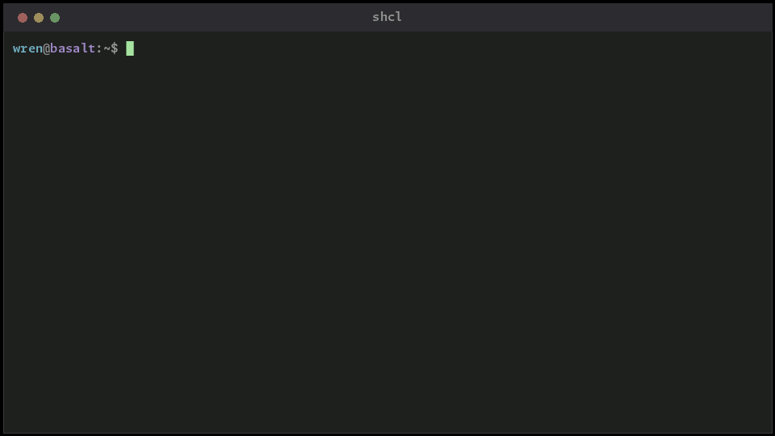

<!-- markdownlint-disable MD007 -- Unordered list indentation -->
<!-- markdownlint-disable MD010 -- hard tabs -->
<!-- markdownlint-disable MD033 -- inline html -->
<!-- markdownlint-disable MD055 -- Table pipe style [Expected: leading_and_trailing; Actual: leading_only; Missing trailing pipe] -->
<!-- markdownlint-disable MD041 -- First line in a file should be a top-level heading -->
<!-- markdownlint-disable MD026 -- Trailing punctuation in heading; the "compares to..." ellipsis is deliberate -->

<!-- TOC ignore:true -->
# SHCL

**S**imple **H**ierarchical **C**onfig **L**anguage

*A config format for files people edit by hand. Forgiving to write, predictable to read.*

<!-- width = the gif's own pixel width, so it never renders larger than 1:1; no height attr, so a narrow column can still shrink it without squashing -->

<!-- [Watch the walkthrough](https://www.youtube.com/watch?v=VIDEO_ID) -->

 

- A save never deletes a line you typed. If the write would delete a line or value from the file, the save refuses rather than dropping it.

- Comments and blank lines survive a rewrite, attached to what they documented.

- One bad line costs you that line, not the file.

- Your code decides a value's type when it reads it. Nothing is guessed at parse time.

- The same file reads the same in every language. The Rust reference and the Go, Python, and C/C++ bindings produce byte-for-byte identical output for valid UTF-8, held to one conformance corpus. Zig uses the C header as is.

- Each binding is one drop-in source file with no dependencies. The CLI is a single binary, and shell scripts call it directly.

- Prebuilt for Linux, macOS and Windows, x86_64 and ARM64, and for FreeBSD on x86_64. Everything else builds from source with `cargo install shcl`.

- Releases are signed, and the binaries are reproducible from the tag.

- A complete specification and grammar. MIT License.

<!-- TOC ignore:true -->
## Table of contents

<!-- TOC -->

- [The problem](#the-problem)
- [What SHCL does about it](#what-shcl-does-about-it)
- [How it compares to...](#how-it-compares-to)
	- [Config languages - JSON, YAML, TOML, XML](#config-languages---json-yaml-toml-xml)
	- [When SHCL is the wrong choice](#when-shcl-is-the-wrong-choice)
- [More features](#more-features)
- [SHCL is used by multiple projects](#shcl-is-used-by-multiple-projects)
- [What a .shcl file looks like](#what-a-shcl-file-looks-like)
- [Escapes](#escapes)
- [Installation](#installation)
- [Usage and examples](#usage-and-examples)
- [Set up a development environment](#set-up-a-development-environment)
- [Docs](#docs)
- [Contributing and support](#contributing-and-support)
- [Legal stuff](#legal-stuff)

<!-- /TOC -->

## The problem

You have probably lived some version of this:

- A whole service refused to start because one line of config had a typo.

- YAML turned `country: NO` into `false`. (Norway. It really does that.)

- JSON needed a comment, and JSON does not do comments.
	- Or a trailing comma killed the parse.

- TOML was pleasant right up until the data nested three levels deep.

- You wanted an integer. You got a string, or an exception, or a silent zero you did not notice until production.

- That one project that stored a complex nested config in XML. You still have PTSD from it.

Every mainstream format makes you do the careful work, and punishes the whole file for one mistake.

## What SHCL does about it

SHCL (canonically pronounced "SHiCkLe") flips the burden around. Modern CPU cycles are cheap, even on embedded systems. Brainpower isn't.

So the parser does the hard work - not the person writing the file, and not the programmer consuming the configuration.

SHCL makes a contract:

- Types live in your code, not in the file. The file stores text. You ask for a type when you read a value. Nothing is guessed at parse time, so there is no "Norway problem".

- One broken line never takes down the file. It is skipped with a note. Everything else that can still be loaded safely, is.

- Every convenience read states a fallback at the call site. A missing value cannot sneak in as a silent zero.

- If a person can tell what a line means, the parser can too.

When you do want zero-tolerance rigor: schema validation, plus a strict mode that fails loudly.

## How it compares to...

### Config languages - JSON, YAML, TOML, XML

|                                       | SHCL                       | JSON            | YAML                                      | TOML                           | XML
| :---                                  | :---                       | :---            | :---                                      | :---                           | :---
| Comments                              | ✅                          | 🚫               | ✅                                         | ✅                              | ✅
| Unquoted strings                      | ✅                          | 🚫               | ✅ But the parser may silently change type | 🚫                              | 🚫
| Bad lines don't break the whole thing | ✅                          | 🚫               | 🚫                                         | 🚫                              | 🚫
| Who decides a value's type            | Your code, at read time    | The file        | The parser guesses                        | The file                       | Your code
| Deep nesting                          | Indent or dot paths, mixed | Brace pyramids  | Indent, whitespace-fragile                | `[a.b.c]` headers get old fast | Tag soup
| Nested arrays                         | 🚫 Use repeated instances   | ✅               | ✅                                         | ✅                              | Repeated child tags
| Nested object definitions             | ✅                          | ✅               | ✅                                         | ✅                              | ✅
| Multi-line verbatim blocks            | Fenced, like Markdown      | Escaped strings | Block scalars, with rules to memorize     | Multi-line strings             | CDATA
| Hand-editable by a non-programmer     | ✅                          | Risky           | Risky                                     | ✅ Mostly                       | 🚫
| Tells you what it fixed               | ✅ Structured diagnostics   | 🚫               | 🚫                                         | 🚫                              | 🚫

> *A note on types, because it is the big design difference: JSON and TOML store types in the file, so the author has to get them right. YAML infers types from the text, which is where `NO` becomes `false`. SHCL stores plain text and coerces when **you** ask for a type; the only code that decides a value is an int (for example), is the code that needed an int.*

The benchmark numbers, and how SHCL differs from Pkl, CUE, and Dhall, are in [Compared to other config languages](project/comparison.md).

### When SHCL is the wrong choice

- You need expressions, functions, or imports inside the file itself. Use Pkl (arguably best), CUE, or Dhall.

- You are serializing machine-to-machine data at high volume. Use JSON or something binary. SHCL is for files that people edit.

- You want the whole file decoded into a struct in one call, the way TOML and YAML libraries do it. SHCL reads one path at a time, and that is [by design](project/design.md#consumer-api).

## More features

Beyond the list at the top:

- Hierarchy by indentation or dot paths (`site(blog.example.com).tls.hsts: off`), freely mixed. Both give the same tree.

- Reads come as int, float, bool, datetime, duration, size, string, or raw block. Int, float, bool, datetime, and string reads have array forms too.

- Repeated fields are queryable as a set. Count them, list them, or fan one read across all of them with `site(*).root` and get a status per slot.

- Raw fenced blocks embed anything verbatim: SQL, code, templates, Markdown-style.

- Three strictness levels, from most forgiving to fail-on-anything. At Loose, `"$1,200"` reads as 1200 and `15%` as 0.15. Standard and Strict refuse both.

- Every diagnostic has a stable code (`E014`, `V001`), so tooling can match on the code while the prose stays free to improve.

- Schema validation, layered loading (defaults, site, user), and commented starter-config generation, all as library features.

- Safe on untrusted input. A parse can take caps on nodes, array size and diagnostics, so a hostile file cannot run a program out of memory. Nesting is capped at 512 levels for every parse.

- `shcl fmt --check app.shcl` exits 6 when the file is not in canonical form. One line gates formatting in CI.

- A save keeps the file's mode and group, and writes through symlinks. On Windows it also keeps the ACLs and the hidden flag.

- The release gate runs the corpus, a fuzzer, and a four-way check that feeds the same inputs to all four parsers and compares the bytes.

## SHCL is used by multiple projects

These projects use SHCL today, and harden it in the process:

| Project                                                                                    | OSS? | Release status | Used for
| :--                                                                                        | :--: | :--            | :--
| [SilkTerm](https://github.com/jim-collier/silkterm)                                        |  Y   | beta           | Config & UI language
| [Nano-Git DB OSS Edition](https://github.com/jim-collier/nano-git-db)                      |  Y   | beta           | Config & DDL
| [Nano-Git DB Enterprise Edition](https://www.yottacore.com/product/nano-git-db-enterprise) |  Y   | beta           | Config
| [convert-base-v2](https://github.com/jim-collier/convert-base-v2)                          |  Y   | **stable**     | Config
| [TradeClanker](https://www.yottacore.com/product/tradeclanker)                             |  n   | beta           | Config & User's rules

<!--
| [Rapid Photo Downloader Pro](https://github.com/jim-collier/rapid-photo-downloader-pro)    |  Y   | alpha          | Config
| [Nemo Anywhere](https://www.yottacore.com/product/nemo-anywhere)                           |  Y   | beta           | Config
| SlodWorld                                                                                  |  n   | beta           | Config
| [SlodWorld2](https://www.yottacore.com/product/slodworld2)                                 |  n   | beta           | Config
-->

(Most of these are by the same author.)

## What a .shcl file looks like

Below is an example config for a small web server - the kind of thing nginx makes you learn a bespoke brace language for. All of this is one valid file: indentation and dotted paths are interchangeable, quoting is only needed when a value contains a reserved character, and messy spacing is fine.

~~~~text
# Flat, TOML-style settings
listen: "0.0.0.0:443"
workers: 4
log-level: warn

# Hierarchy when you need it: one instance per site
site: example.com
	root: /srv/www/example
	Max-Upload-MB : 50
	methods: [GET, POST, HEAD]
	tls:
		cert: /etc/ssl/example.pem
		hsts: on

# Repeating the field adds another site - arrays of objects
# no syntax to invent
site: blog.example.com
	root: /srv/www/blog

# Dotted paths give the same tree; add to any instance from anywhere
site("blog.example.com").tls.hsts: off

# Multi-line content goes in a fenced block, kept verbatim
maintenance-page:
	~~~html
	<h1>Down for maintenance - back in five.</h1>
	~~~
~~~~

Field names are case-insensitive. Repeated paths merge. `site` here is not one key but a set of instances (example.com, blog.example.com), each with its own children - arrays of objects without inventing syntax for them.

## Escapes

Escapes work differently than in most formats, and more predictably. A backslash is plain text everywhere, so a Windows path goes in as typed, quoted or not. (JSON, YAML and TOML all read the `\t` and `\n` in `"C:\temp\new"` as a tab and a line break, and the path quietly breaks.)

This "escape problem" is as old as computer text. It's a fix to a problem that eventually caused more problems than it solved - for something most people rarely need. It has three main causes:

1. A common keyboard character starts escape sequences, even though overwhelmingly most text doesn't need to be escaped.

2. There's no escape terminator. So either an escape is limited to one character after the backslash - and it has to be meaningful somehow - or it's hard to tell where the escape ends. (For example in C, `"\x41BC"` is one escape, not an encoded `A` followed by `BC`.)

3. There's no clear, uniform way to escape the escape character itself. (For example, matching 2 backslashes with a regex in a string literal requires `\\\\\\\\`.)

SHCL avoids the whole problem. It has 3 easy ways to write a problem character, and context suggests the easiest one to use:

1. A fenced block, as in Markdown. Everything in it is passed as-is, tabs and line breaks included.

2. A value in backticks, also as in Markdown. It's never decoded, and unlike quotes, `◉` is a plain character inside it. It's also a handy signal to readers that the program reading the value does the interpreting, not SHCL.

3. The SHCL escape mark `◉`, which begins and ends a finite list of escaped characters (including itself).

Examples:

~~~~text
# No surprise escapes here, it's just a literal string.
backup-dir: C:\temp\new

# The standard fenced block approach to give the calling program a formatted string without interpretation.
help-text:
	~~~
	The system may need one or more of:
		- A reboot
		- Some refreshing water
	~~~

# This is returned as a literal string for the calling program to deal with, as it requested.
color: `\x1b[31m`

# Deliberate and obvious escapes, if you don't want to use a fenced block
motd: "Back soon.◉NEWLINE◉◉TAB◉Sorry for the wait."

# As with the previous example, these values here are returned by SHCL with the escapes properly interpreted.
demo-escapes:
	emoji:  "This is a smiley emoji: ◉U+1F600◉."
	escape: "This is the SHCL escape character: ◉ESCAPE_CHAR◉"
~~~~

The full list of escapes is in [the spec](project/spec.md#escapes).

## Installation

Packages for Debian, Fedora, and Windows, the install scripts for the stable and dev channels, the language packages, and a DIY route are in [Installation](project/install.md).

## Usage and examples

[Usage and examples](project/examples.md) shows the `shcl` command from a shell, and the library from Rust, Go, Python, Zig, C, and C++. It also has Bash and PowerShell scripts, and what a save does to the file.

## Set up a development environment

`install-dev.bash` clones the repo and installs the toolchains and linters the pipeline gates on. The one-liner and the gate to run are in [Installation](project/install.md#set-up-a-development-environment), and [`contributing.md`](contributing.md) has the full list.

## Docs

- [`project/install.md`](project/install.md): packages, install scripts, the DIY route, and a development setup.

- [`project/examples.md`](project/examples.md): the CLI from a shell, and the library from each language.

- [`project/comparison.md`](project/comparison.md): size and speed against JSON, YAML, TOML, and XML, and how SHCL differs from Pkl, CUE, and Dhall.

- [`project/spec.md`](project/spec.md): the full language spec. Terminology, types, coercion, the read API, raw blocks, strictness levels.

- [`project/grammar.abnf`](project/grammar.abnf): the formal grammar.

- [`project/design.md`](project/design.md): the why behind the decisions.

- [`changelog.md`](changelog.md): what changed in each release.

- [`contributing.md`](contributing.md): how to help.

- [`project/style-guide_code.md`](project/style-guide_code.md): coding and prose style. The bindings deliberately mirror the reference's structure over per-language idiom, so they stay byte-for-byte in sync.

- [`project/style-guide_ui-ux.md`](project/style-guide_ui-ux.md): how the command line behaves. Option spelling, the help layout, what goes to stdout and what to stderr, and the exit codes.

Generated API reference, per binding: [docs.rs](https://docs.rs/shcl) for Rust, [pkg.go.dev](https://pkg.go.dev/github.com/yottacore/shcl/source/go/v2) for Go.

## Contributing and support

A config parser gets trusted with other people's files, so help and scrutiny are both welcome. Bug reports, spec edge cases, and new-language bindings all count. See [`contributing.md`](contributing.md) to get started.

If SHCL helps but code and issue reports aren't your thing, a star or a mention still helps other people find it - and if it is saving you real time, sponsorship through [GitHub](https://github.com/sponsors/jim-collier) or [Ko-fi](https://ko-fi.com/jimcollier) is welcome.

## Legal stuff

> Copyright © 2026 Jim Collier [ID: 2უNაɘ«҂թȹɤξπ๙¿ձϖ] 
> Licensed under the [MIT License](https://mit-license.org/) 
> SPDX-License-Identifier: `MIT` 
> No warranty. 
> SHCL™ is a [trademark](trademark.md) of Jim Collier. The name means it passes the conformance corpus.
